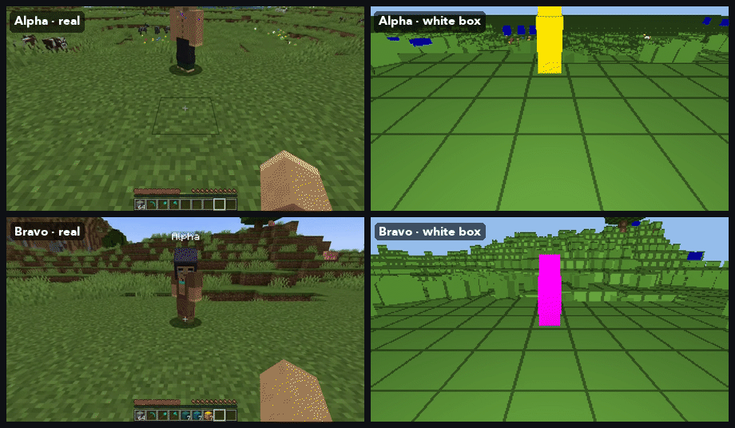
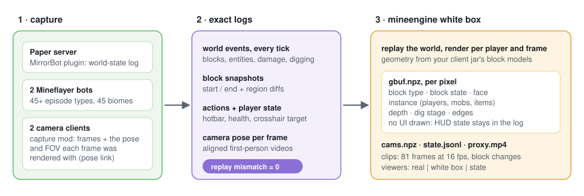
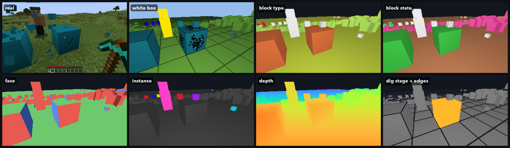
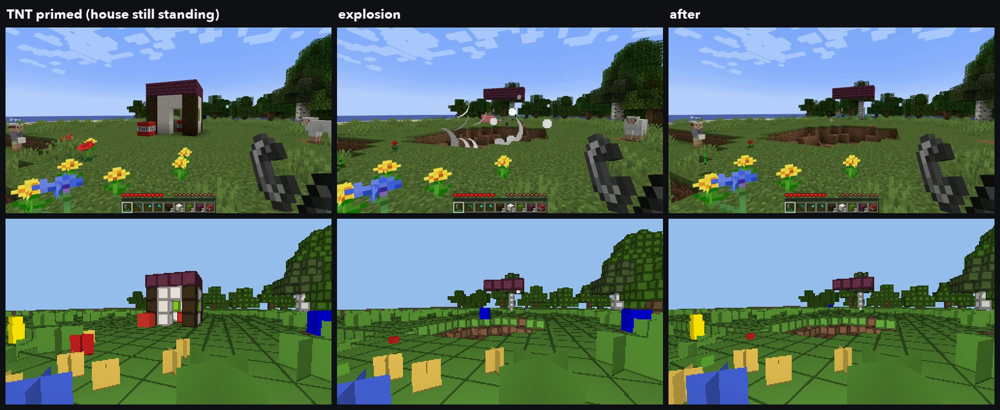
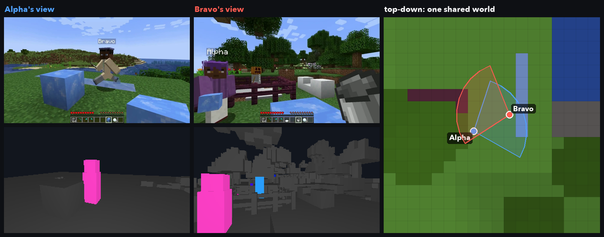
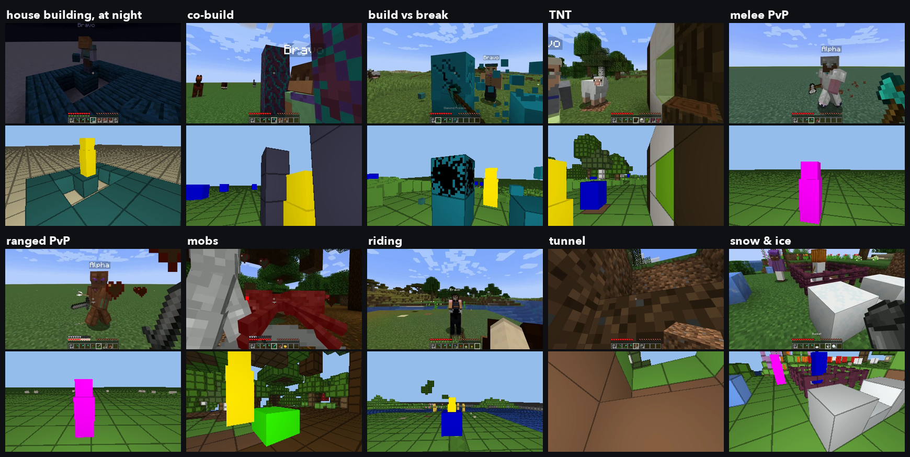
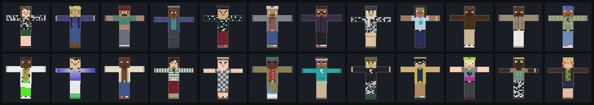

# MineEngine

English | [中文](README_zh.md)

An automated multiplayer Minecraft data engine. Two bots play 45+ kinds of episodes on their own (building, breaking, PvP, mobs, riding, farming, redstone, fluids); every run records both players' first-person videos with exact actions, camera poses and a world-state log that replays exactly, and every frame gets a per-pixel white box rendered from the logged world.

<p align="center"></p>

The left column is the real game; the right column is the white box, rendered from the replayed world state. Rows are the two players at the same moment.

- `capture/` records two players' first-person videos, ground-truth actions, and the camera pose of every rendered frame. It also records a world-state log that replays exactly.
- `mineengine/` turns each capture into training data. From the replayed world it renders the white box: which block, which block state, which face, which entity, and the dig progress. It also writes aligned clips, per-entity reference sheets, statistics and viewers.

The white box is not estimated from video. Every pixel's label comes from the logged world:
- a door's `open` flag;
- a crop's `age`;
- a water `level`;
- which player is where.

<p align="center"> exact logs -> mineengine white box"></p>

## What every pixel holds

<p align="center"></p>

The planes are `[frames, 192, 336]`; the full spec is in [docs/whitebox_channels.md](docs/whitebox_channels.md).

| channel | meaning |
|---|---|
| `btype` | block type (index into `types.json` = registry types of your client jar) |
| `bstate` | full block state (index into the episode's `states.json`, e.g. `minecraft:oak_door[facing=east,half=lower,open=true]`) |
| `face` | which face of the block (±x, ±y, ±z) |
| `pid` | instance: 1 = the other player, 2.. = mobs, items, primed TNT |
| `fx` | block-breaking stage of the block being dug |
| `logdepth`, `shade`, `edge` | log depth, shading, block-face borders |

Geometry comes from the jar's block models: slabs, stairs, doors, crops, torches, rails, fluids by level, waterlogged blocks. UI is never drawn into the white box; HUD state (health, hotbar, crosshair target) stays in the per-frame log.

## The world changes, the white box follows

<p align="center"></p>

Every block change is logged and replayed: placing, breaking, explosions, doors, crops, water. The crater in the white box is the logged crater, block for block. The mesh follows every state change, and only the 16 × 16 columns around a change are re-meshed.

## Two players, one shared world

<p align="center"></p>

- Both videos are aligned in time.
- Every frame has the camera pose and FOV that rendered it.
- Each player's pixels in the other's view are labelled exactly (`pid`, magenta).

## What it records

<p align="center"></p>

| | |
|---|---|
| Players | Two bots act together: build, break, fight, ride, farm, use redstone and fluids. There are 45+ episode types in 45 biomes plus flat worlds, with mixed weather and time of day. |
| Video | A Fabric mod captures frames inside each camera client (NVENC or x264). For every frame it logs the camera pose and FOV that were actually rendered. The FOV is fixed at 70°. |
| Actions | Per-frame action labels. A UDP pose link pairs every action with the exact frame that rendered it. |
| World state | Per-tick entities, damage, knockback and deaths, swings, item use and digging progress. Every block that was touched is read back each tick, and the whole region is diffed every second. The log replays the world exactly. |
| Player state | Hotbar, armour, health, food, status effects and crosshair target, per frame. |
| Scale | Windows-native or headless Linux (Xvfb + VirtualGL / EGL). On RTX 6000D GPUs we ran 4 capture instances per GPU and collected about 3,000 two-player episodes in two waves. |

Comments in the code cite requirement ids such as `T12` (camera sync) or `T16` (per-frame player state); [docs/requirements.md](docs/requirements.md) lists all of them and where each one lives.

<p align="center"></p>

Skins are 300 procedural skins plus a held-out set of 24, and the 18 Minecraft defaults (extracted from your own client at setup). Every skin has a front / back / side reference sheet. On the native Windows and Linux runners, skins are rendered locally, with no online service. The older Docker path can only show Mojang-signed skins, which need a one-time upload to MineSkin ([capture/STATEFUL_CAPTURE.md](capture/STATEFUL_CAPTURE.md), section 3.6).

## Quick start

Requirements:
- for capture: an NVIDIA GPU, Java 21, Node 18+, Python 3.10+, and Docker only for `build_plugin.sh` and the Docker path;
- for `mineengine`: Python 3.10+ with numpy, OpenCV, Pillow, PyTorch and PyAV (all installed by `pip install -e .`).

GPU rendering uses nvdiffrast (about 1.5 ms per 192 × 336 frame). A CPU rasteriser with the same channels is built in (`cap2proxy --cpu-render`). The GPU self-test compares the two pixel by pixel: about 0.1 % of pixels differ, and the player channel matches exactly. nvdiffrast's licence allows research or evaluation use only; for commercial use, stay on the CPU rasteriser.

```bash
pip install -e .                                   # the mineengine package
# capture setup (installs Paper, the camera client, the capture mod): capture/README.md, capture/linux/README.md
python scripts/setup_assets.py                     # block registry, default skins, HUD template from YOUR client jar; plugins (sha256-pinned)
# MirrorBot Paper plugin: on Windows, setup_windows.cmd builds it with Maven;
# on Linux, run bash capture/server/build_plugin.sh (needs Docker) or pass --maven to capture/windows/setup_windows.py

# record (Windows)                                  # or headless Linux: bash capture/linux/run_headless.sh ...
capture\run_windows.cmd --accept-minecraft-eula --mode diverse --episodes 20 --output-dir out

# white box
python -m mineengine.cap2proxy --root out/data_collection/train/batch_0 --out wb --clips --cpu-render   # drop --cpu-render once nvdiffrast + CUDA are installed
python -m mineengine.view --ep wb/episodes/<episode> --report out/data_collection/train/batch_0/world_events_report.json --out view.mp4

# self-tests (CPU, no Minecraft needed: synthetic episodes)
bash tests/run_cpu_selftests.sh
```

## Minecraft, assets and licences

- `--accept-minecraft-eula` means that **you**, the operator, accept the [Minecraft EULA](https://aka.ms/MinecraftEULA). Servers and clients run in offline mode and never use a Microsoft or Mojang account.
- You need your own Minecraft: Java Edition licence. Offline mode only lets the automated local capture run without logging in; it does not change that.
- This repository ships no Minecraft game files (code, textures, models, sounds); its only Minecraft content is the gameplay in the screenshots and animations, see [NOTICE](NOTICE). The client jar, the default skins, the block models and the one HUD sprite the water-episode filter needs are read from your own installation by `scripts/setup_assets.py`.
- Third-party plugins are downloaded from their official releases at setup, under their own licences: [THIRD_PARTY.md](THIRD_PARTY.md).
- `capture/` is derived from [SolarisEngine](https://solaris-wm.github.io/solaris-engine/) (Apache-2.0): [NOTICE](NOTICE).
- The screenshots in this README are frames of our own captures; the diagram and the skin sheet are made by us.
- Captures record absolute paths of your machine (for example in `run_config.json` and the aligned `*_meta.json` files). Check them before you share a dataset; see [THIRD_PARTY.md](THIRD_PARTY.md).
- NOT AN OFFICIAL MINECRAFT PRODUCT. NOT APPROVED BY OR ASSOCIATED WITH MOJANG OR MICROSOFT.

Licence: this repository's own code, the procedural skins, their reference sheets and the data tables are Apache-2.0 ([LICENSE](LICENSE), [NOTICE](NOTICE)). The files listed in [THIRD_PARTY.md](THIRD_PARTY.md) keep their own licences. The Minecraft content in the gameplay images is © Mojang / Microsoft and is not covered by Apache-2.0.
