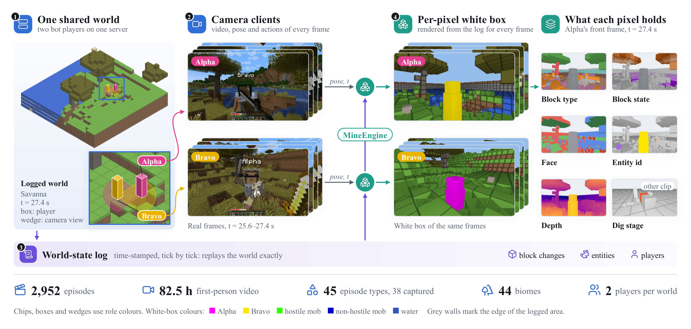
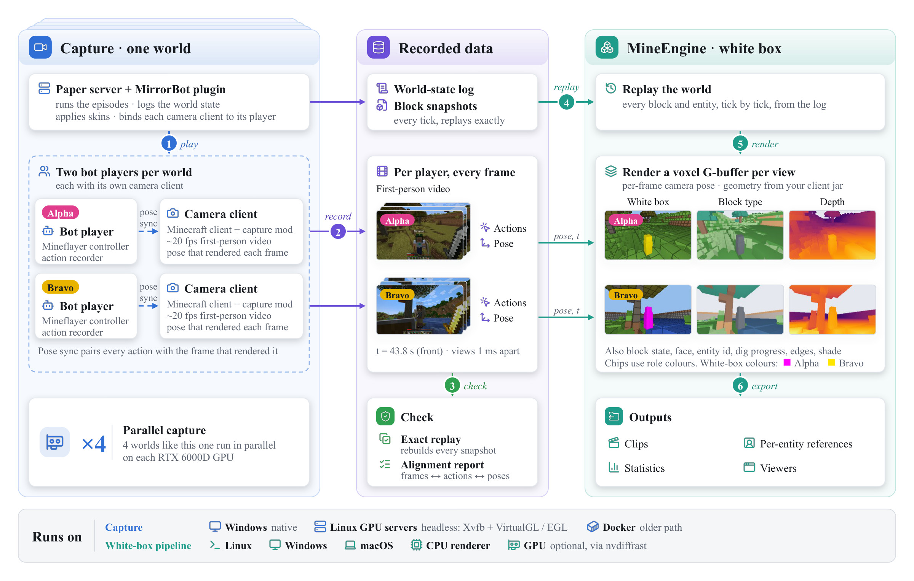
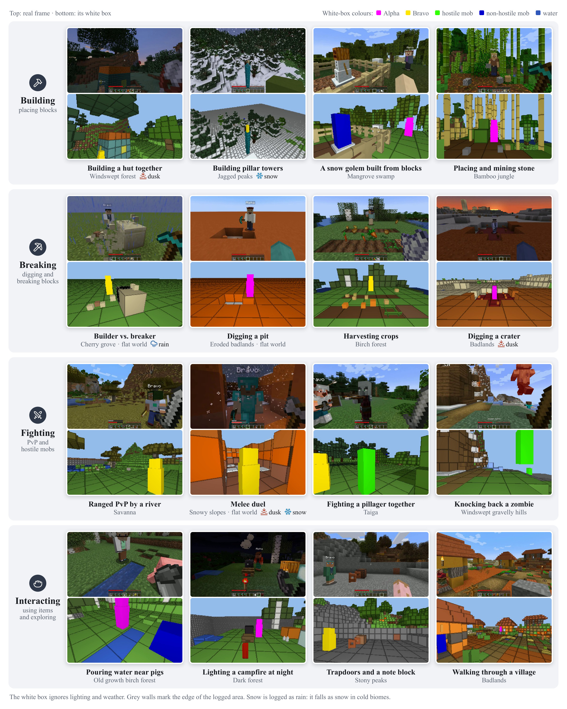
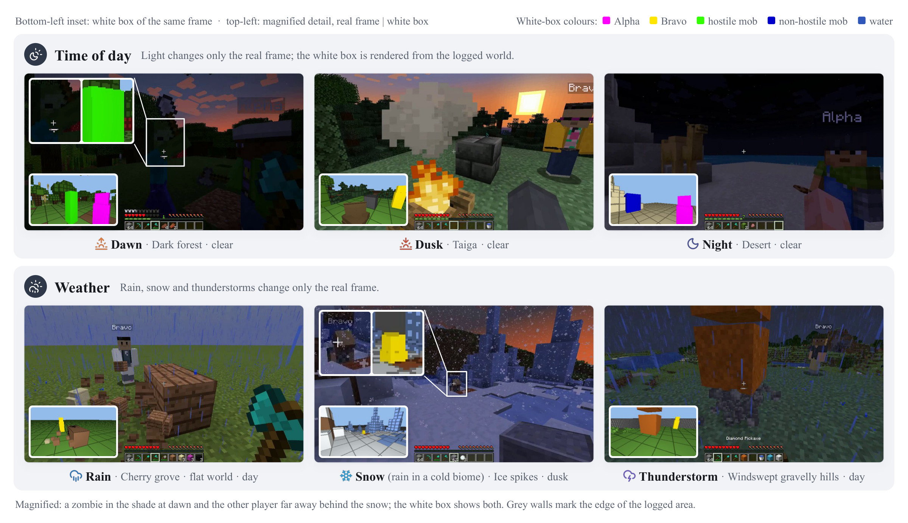
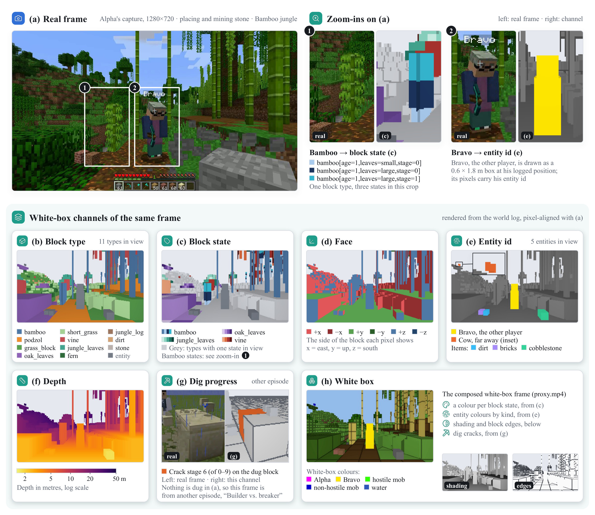
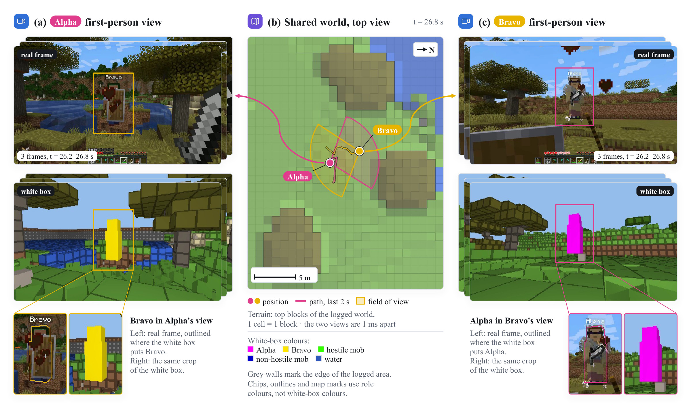
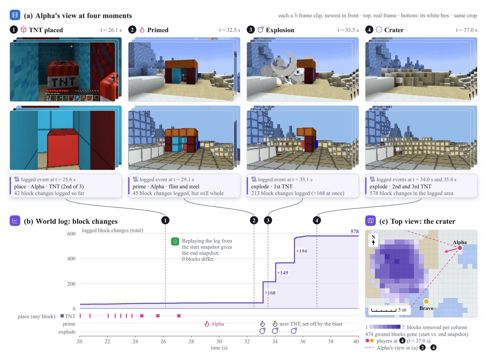
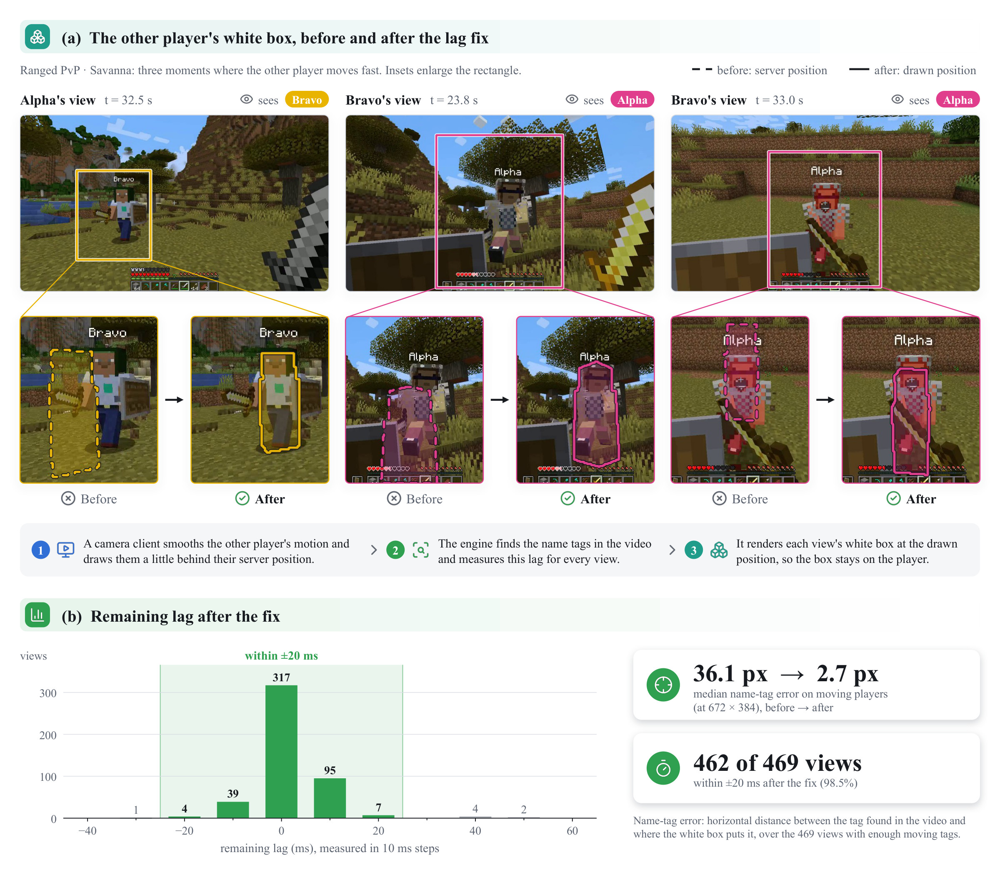
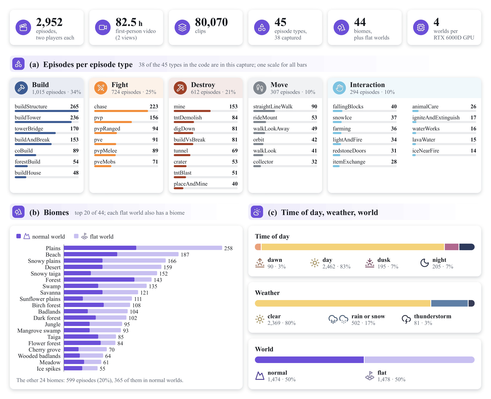

# MineEngine

English | [中文](README_zh.md)

An automated multiplayer Minecraft data engine. Bot players play 45 types of episodes on their own: building, breaking, PvP, fighting mobs, riding, farming, redstone, water and lava. For every player it records the first-person video, the action of every frame and the camera pose that rendered it; for every world, a state log that replays exactly. From that log it renders a per-pixel white box of every frame.

<p align="center"></p>

- **Multiplayer.** Every world runs two bot players, each with its own camera client, and many worlds run in parallel (4 per RTX 6000D GPU). More players per world is work in progress.
- **Exact, not estimated.** Every white-box pixel comes from the logged world: which block, which state (a door's `open`, a crop's `age`, a water `level`), which face, which entity, how far it is dug. The log replays the world block for block.
- **Aligned with the video.** Each view's white box draws the other players where that player's client drew them; on moving players the median name-tag error is 2.7 px.
- **Diverse.** 45 episode types, 44 biomes plus flat worlds, dawn, day, dusk and night, rain, snow and thunderstorms.
- **Runs on your machines.** Capture runs natively on Windows and headless on Linux GPU servers (a Docker path is kept too); the white-box pipeline is pure Python.

## How it works

<p align="center"></p>

- `capture/` runs the worlds. A Paper server with the MirrorBot plugin starts the episodes, logs the world state and binds each camera client to its player. Mineflayer bots play; each bot has a camera client (a real Minecraft client with our capture mod) that records the first-person video and the pose of every rendered frame.
- `mineengine/` turns each capture into training data: it replays the world, renders the white box of every view (block type, block state, face, entity id, depth, dig stage) and writes aligned clips, per-entity reference sheets, statistics and viewers.

## Scenes

<p align="center"></p>

<p align="center"></p>

## What every pixel holds

<p align="center"></p>

The planes are `[frames, 192, 336]`; the full spec is in [docs/whitebox_channels.md](docs/whitebox_channels.md).

| channel | meaning |
|---|---|
| `btype` | block type (index into `types.json` = registry types of your client jar) |
| `bstate` | full block state (index into the episode's `states.json`, e.g. `minecraft:oak_door[facing=east,half=lower,open=true]`) |
| `face` | which face of the block (±x, ±y, ±z) |
| `pid` | instance: 1 = the other player, 2.. = mobs, items, primed TNT |
| `fx` | block-breaking stage of the block being dug |
| `logdepth`, `shade`, `edge` | log depth, shading, block-face borders |

Geometry comes from the jar's block models: slabs, stairs, doors, crops, torches, rails, fluids by level, waterlogged blocks. UI is never drawn into the white box; HUD state (health, hotbar, crosshair target) stays in the per-frame log.

## Multiplayer: one shared world

<p align="center"></p>

<p align="center"></p>

- Both players' videos are aligned in time; every frame has the camera pose and FOV that rendered it.
- Each player's pixels in the other's view are labelled exactly (`pid`).
- Today each world holds two players, and many worlds run in parallel; more players per world is work in progress.

## The world changes, the white box follows

<p align="center"></p>

Every block change is logged and replayed: placing, breaking, explosions, doors, crops, water. The crater in the white box is the logged crater, block for block; replaying the log from the start snapshot gives the end snapshot exactly. Only the 16 × 16 columns around a change are re-meshed.

## The white box lines up with the video

<p align="center"></p>

A camera client smooths the motion of the other players and draws them a little behind their server position (about 0.16 s). The engine measures this lag for every view from the name tags in the video and draws the other players where the client drew them.

## The captured dataset

<p align="center"></p>

| | |
|---|---|
| Players | Two bots per world act together: build, break, fight, ride, farm, use redstone and fluids. 45 episode types (38 of them in our capture), 44 biomes plus flat worlds, mixed weather and time of day. |
| Video | A Fabric mod captures frames inside each camera client (NVENC or x264). For every frame it logs the camera pose and FOV that were actually rendered. The FOV is fixed at 70°. |
| Actions | Per-frame action labels. A UDP pose link pairs every action with the exact frame that rendered it. |
| World state | Per-tick entities, damage, knockback and deaths, swings, item use and digging progress. Every block that was touched is read back each tick, and the whole region is diffed every second. The log replays the world exactly. |
| Player state | Hotbar, armour, health, food, status effects and crosshair target, per frame. |
| Scale | On RTX 6000D GPUs we ran 4 capture worlds per GPU on headless Linux and collected 2,952 two-player episodes (82.5 h of first-person video) in two waves. |

Comments in the code cite requirement ids such as `T12` (camera sync) or `T16` (per-frame player state); [docs/requirements.md](docs/requirements.md) lists all of them and where each one lives.

<p align="center"></p>

Skins are 300 procedural skins plus a held-out set of 24, and the 18 Minecraft defaults (extracted from your own client at setup). Every skin has a front / back / side reference sheet. On the native Windows and Linux runners, skins are rendered locally, with no online service. The older Docker path can only show Mojang-signed skins, which need a one-time upload to MineSkin ([capture/STATEFUL_CAPTURE.md](capture/STATEFUL_CAPTURE.md), section 3.6).

## Platforms

| | Windows 10 / 11 | Linux | macOS |
|---|---|---|---|
| Capture | native: `capture\run_windows.cmd` | headless GPU servers: `capture/linux/run_headless.sh` (Xvfb + VirtualGL / EGL); laptops: the Docker path | not tested |
| White-box pipeline (`mineengine`) | CPU self-tests in CI | CPU self-tests in CI; GPU rendering with nvdiffrast | CPU self-tests in CI |

## Quick start

Requirements:
- for capture: an NVIDIA GPU, Java 21, Node 18+, Python 3.10+, and Docker only for `build_plugin.sh` and the Docker path;
- for `mineengine`: Python 3.10+ with numpy, OpenCV, Pillow, PyTorch and PyAV (all installed by `pip install -e .`).

GPU rendering uses nvdiffrast (about 1.5 ms per 192 × 336 frame). A CPU rasteriser with the same channels is built in (`cap2proxy --cpu-render`). The GPU self-test compares the two pixel by pixel: about 0.1 % of pixels differ, and the player channel matches exactly. nvdiffrast's licence allows research or evaluation use only; for commercial use, stay on the CPU rasteriser.

```bash
pip install -e .                                   # the mineengine package
# capture setup (installs Paper, the camera client, the capture mod): capture/README.md, capture/linux/README.md
python scripts/setup_assets.py                     # block registry, default skins, HUD template from YOUR client jar; plugins (sha256-pinned)
# MirrorBot Paper plugin: on Windows, setup_windows.cmd builds it with Maven;
# on Linux, run bash capture/server/build_plugin.sh (needs Docker) or pass --maven to capture/windows/setup_windows.py

# record (Windows)                                  # or headless Linux: bash capture/linux/run_headless.sh ...
capture\run_windows.cmd --accept-minecraft-eula --mode diverse --episodes 20 --output-dir out

# white box
python -m mineengine.cap2proxy --root out/data_collection/train/batch_0 --out wb --clips --cpu-render   # drop --cpu-render once nvdiffrast + CUDA are installed
python -m mineengine.view --ep wb/episodes/<episode> --report out/data_collection/train/batch_0/world_events_report.json --out view.mp4

# self-tests (CPU, no Minecraft needed: synthetic episodes)
bash tests/run_cpu_selftests.sh
```

## Minecraft, assets and licences

- `--accept-minecraft-eula` means that **you**, the operator, accept the [Minecraft EULA](https://aka.ms/MinecraftEULA). Servers and clients run in offline mode and never use a Microsoft or Mojang account.
- You need your own Minecraft: Java Edition licence. Offline mode only lets the automated local capture run without logging in; it does not change that.
- This repository ships no Minecraft game files (code, textures, models, sounds); its only Minecraft content is the gameplay in the screenshots and animations, see [NOTICE](NOTICE). The client jar, the default skins, the block models and the one HUD sprite the water-episode filter needs are read from your own installation by `scripts/setup_assets.py`.
- Third-party plugins are downloaded from their official releases at setup, under their own licences: [THIRD_PARTY.md](THIRD_PARTY.md).
- `capture/` is derived from [SolarisEngine](https://solaris-wm.github.io/solaris-engine/) (Apache-2.0): [NOTICE](NOTICE).
- The screenshots in this README are frames of our own captures; the diagram and the skin sheet are made by us.
- Captures record absolute paths of your machine (for example in `run_config.json` and the aligned `*_meta.json` files). Check them before you share a dataset; see [THIRD_PARTY.md](THIRD_PARTY.md).
- NOT AN OFFICIAL MINECRAFT PRODUCT. NOT APPROVED BY OR ASSOCIATED WITH MOJANG OR MICROSOFT.

Licence: this repository's own code, the procedural skins, their reference sheets and the data tables are Apache-2.0 ([LICENSE](LICENSE), [NOTICE](NOTICE)). The files listed in [THIRD_PARTY.md](THIRD_PARTY.md) keep their own licences. The Minecraft content in the gameplay images is © Mojang / Microsoft and is not covered by Apache-2.0.
