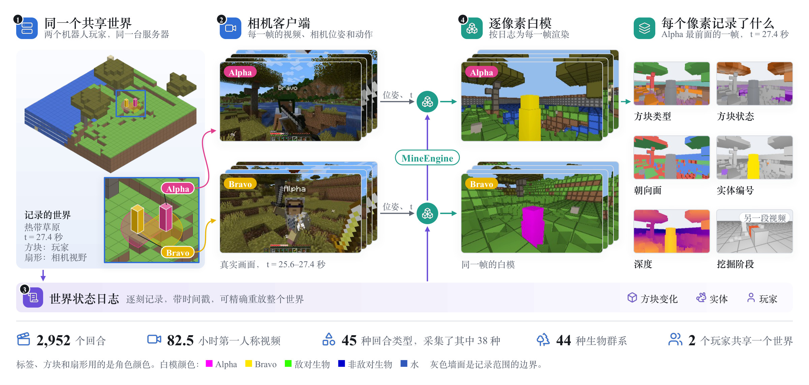
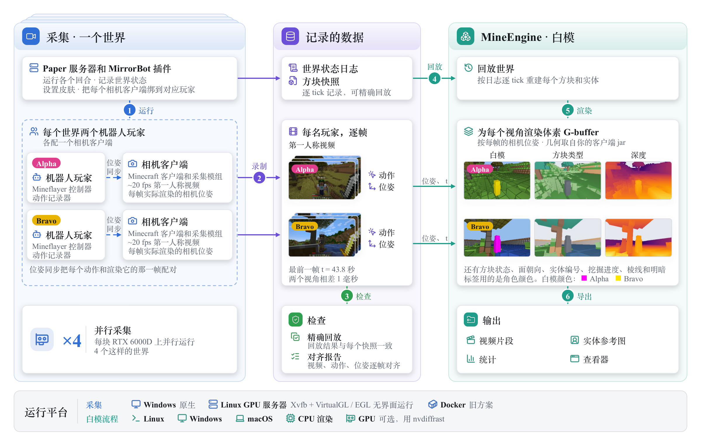
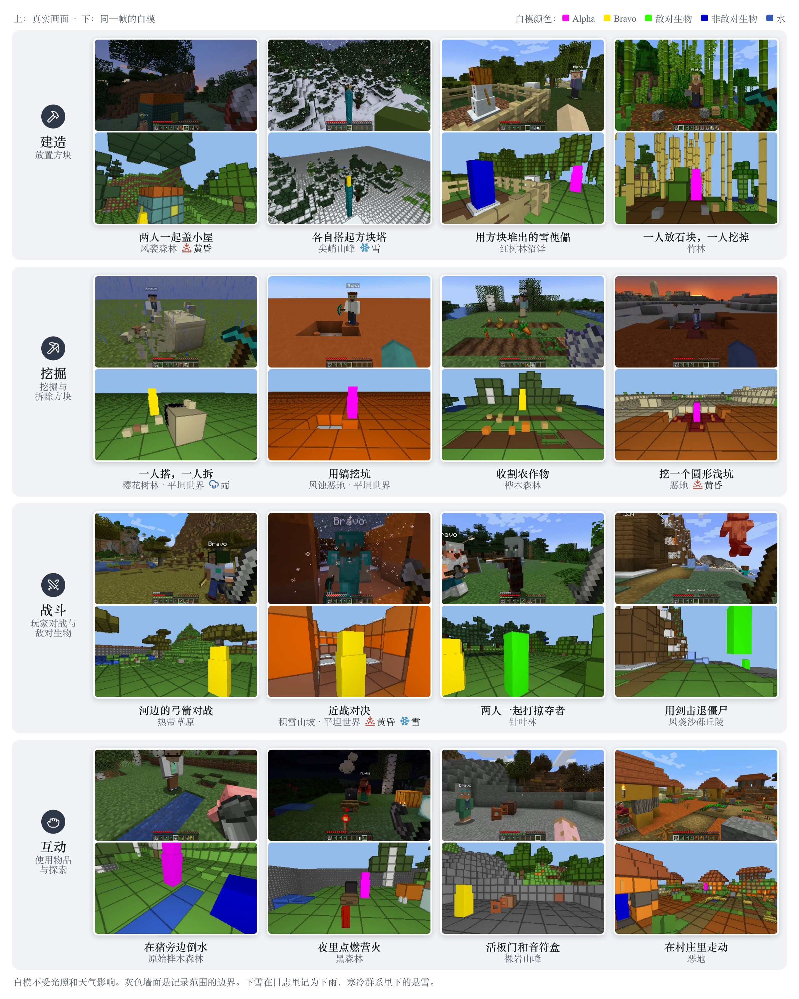
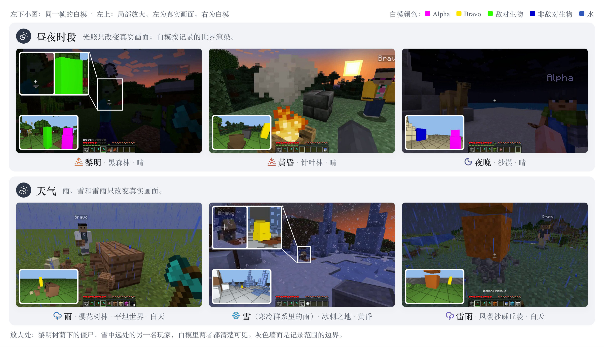
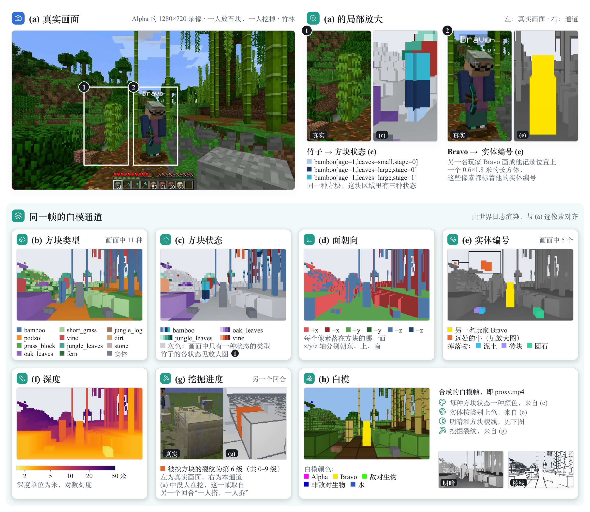
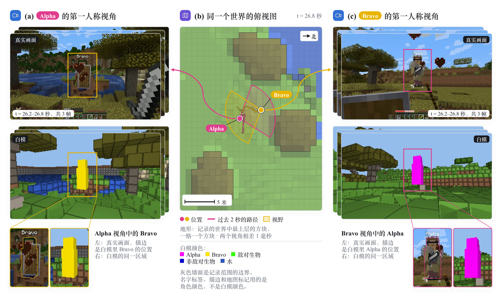
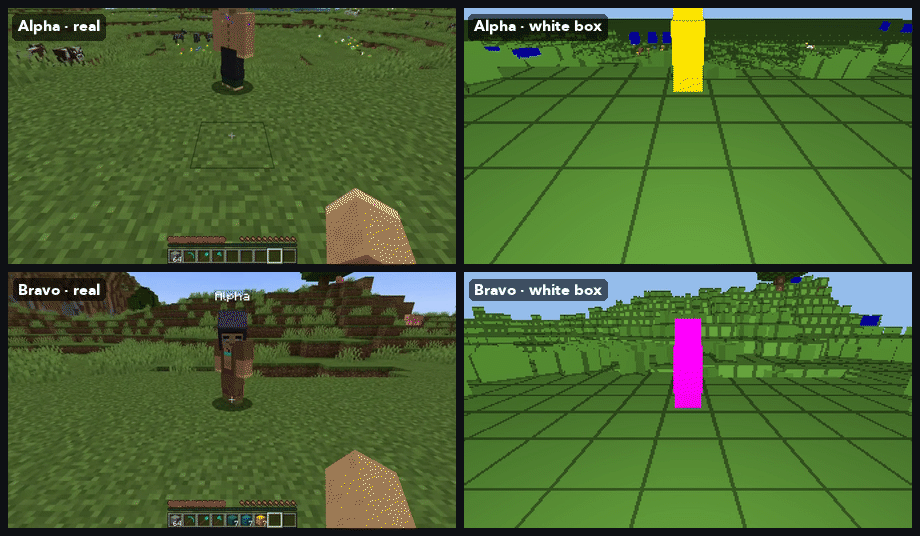
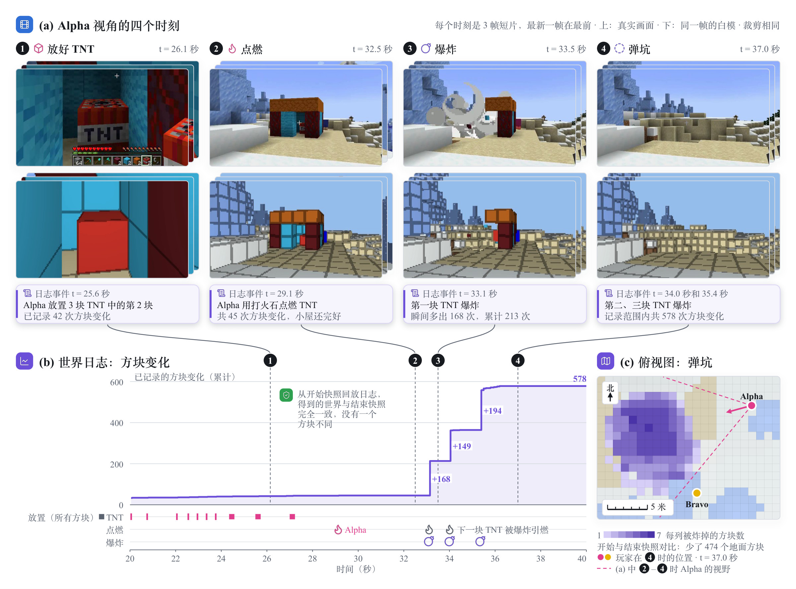
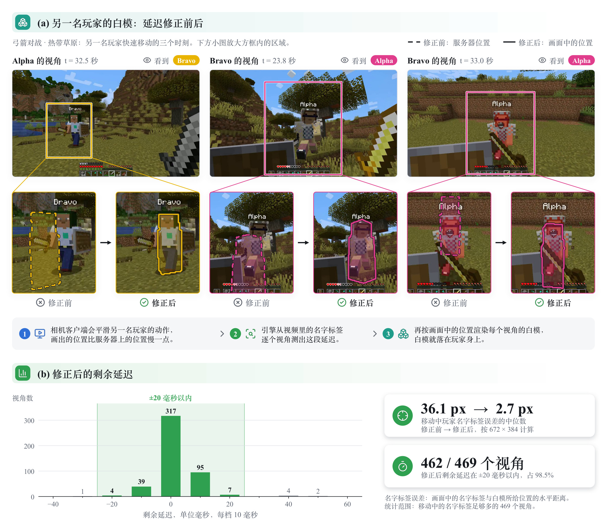
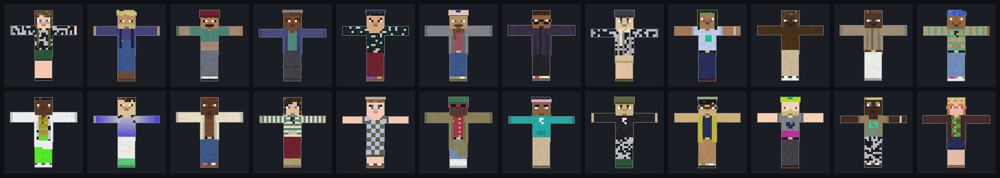

# MineEngine

[English](README.md) | 中文

全自动的 Minecraft 多人数据引擎：bot 玩家自己玩 45 种回合，包括建造、拆除、PvP、打怪、骑乘、种地、红石、水和岩浆。引擎给每名玩家录下第一视角视频、每一帧的动作和渲染这一帧所用的相机位姿，给每个世界录下能精确重放的世界状态日志，再按日志把每一帧逐像素渲染成“白模”。

<p align="center"></p>

- **多人。** 每个世界里有两个 bot 玩家，各自配一个相机客户端；很多个世界可以同时跑，一张 RTX 6000D 显卡同时跑 4 个。一个世界放更多玩家的功能正在开发。
- **白模是精确的，不是估计的。** 白模的每个像素都来自记录下来的世界：是什么方块、什么状态（门开没开、作物长到第几阶段、水位多高）、哪一面、哪个实体、挖到了第几阶段。日志能一格不差地重放整个世界。
- **和画面对得上。** 每个视角的白模，都把其他玩家画在这名玩家的客户端实际画出他们的位置；对方跑动时，名字标签的偏差中位数是 2.7 像素。
- **场景多样。** 45 种回合类型、44 种地形加超平坦世界，有黎明、白天、黄昏、夜晚，也有雨、雪和雷雨。
- **在你自己的机器上跑。** 采集可以在 Windows 上直接运行，也可以在没有显示器的 Linux GPU 服务器上运行（老的 Docker 用法也保留着）；白模流水线是纯 Python。

## 工作原理

<p align="center"></p>

- `capture/` 负责跑世界。带 MirrorBot 插件的 Paper 服务器负责开局、记录世界状态，并把每个相机客户端绑到对应的玩家上。Mineflayer bot 负责玩；每个 bot 配一个相机客户端（装了我们采集模组的真实 Minecraft 客户端），录第一视角视频和每一帧实际渲染用的相机位姿。
- `mineengine/` 把采集结果变成训练数据：重放世界，给每个视角渲染白模（方块类型、方块状态、朝向面、实体编号、深度、挖掘阶段），再输出对齐好的片段、每个实体的参考图、统计和可视化。

## 各种场景

<p align="center"></p>

<p align="center"></p>

## 每个像素记了什么

<p align="center"></p>

| 通道 | 含义 |
|---|---|
| `btype` | 方块类型：用的是你本机客户端 jar 里的方块注册表，1000 多种 |
| `bstate` | 完整方块状态，例如 `minecraft:oak_door[facing=east,half=lower,open=true]` |
| `face` | 看到的是方块的哪一面（±x、±y、±z） |
| `pid` | 实体编号：1 = 另一名玩家，2 以后是生物、掉落物、点燃的 TNT |
| `fx` | 正在被挖的方块挖到了第几阶段 |
| `logdepth`、`shade`、`edge` | 深度、明暗、方块棱线 |

完整说明见 [docs/whitebox_channels.md](docs/whitebox_channels.md)。

几何形状来自客户端 jar 里的方块模型：台阶、楼梯、门、作物、火把、铁轨、不同水位的水、含水方块都按原样画。白模里不画界面；血量、物品栏、准星指向这些状态记在每一帧的日志里。

## 多人：同一个世界

<p align="center"></p>

<p align="center"></p>

- 两名玩家的视频按时间对齐；每一帧都记录了渲染它的相机位置、朝向和视场角。
- 对方玩家在自己画面里占的像素是精确标出来的（`pid`）。
- 现在每个世界里有两名玩家，很多个世界可以同时跑；一个世界放更多玩家的功能正在开发。

## 世界在变，白模跟着变

<p align="center"></p>

放方块、拆方块、爆炸、开门、作物生长、水流，每一次变化都写进日志并重放。白模里炸出的坑就是日志里记录的坑，一格不差；从开局快照按日志重放，得到的就是结束时的快照。哪里有变化，就只重新生成那一块 16 × 16 区域的网格。

## 白模和画面对得上

<p align="center"></p>

相机客户端会把其他玩家的动作做平滑处理，画出来的位置比服务器上的位置慢一点（约 0.16 秒）。引擎从画面里的名字标签测出每个视角的这段延迟，再把其他玩家画在客户端实际画出他们的位置。

## 采集的数据

<p align="center"></p>

- 45 种回合类型（这次采集用了其中 38 种）：建造、拆除、PvP、打怪、骑乘、种地、红石、流体……
- 44 种地形加超平坦世界，天气和时间随机变化。
- 每个世界两名玩家一起行动，动作逐帧对齐。
- 我们在 RTX 6000D 显卡上每张卡同时跑 4 个采集世界，两轮共采了 2,952 个双人回合（82.5 小时第一视角视频）。

代码注释里的 `T12`（相机同步）、`T16`（每帧玩家状态）这类编号，对照表见 [docs/requirements_zh.md](docs/requirements_zh.md)。

<p align="center"></p>

- 皮肤：300 个程序生成皮肤，另有 24 个留作测试。
- 18 个 Minecraft 默认皮肤在安装时从你自己的客户端里提取。
- 每个皮肤都有正面、背面、侧面参考图。
- 用 Windows 或 Linux 原生方式采集时，皮肤全部在本地渲染，不依赖任何在线服务。老的 Docker 路径只能显示 Mojang 签过名的皮肤，要先把皮肤上传到 MineSkin 网站一次（见 [capture/STATEFUL_CAPTURE_zh.md](capture/STATEFUL_CAPTURE_zh.md) 第 3.6 节）。

## 支持的系统

| | Windows 10 / 11 | Linux | macOS |
|---|---|---|---|
| 采集 | 原生运行：`capture\run_windows.cmd` | 无显示器的 GPU 服务器：`capture/linux/run_headless.sh`（Xvfb + VirtualGL / EGL）；笔记本：Docker 用法 | 未测试 |
| 白模流水线（`mineengine`） | CI 跑 CPU 自测 | CI 跑 CPU 自测；可用 nvdiffrast 做 GPU 渲染 | CI 跑 CPU 自测 |

## 快速开始

需要：
- 采集：NVIDIA 显卡、Java 21、Node 18+、Python 3.10+；只有 `build_plugin.sh` 和 Docker 路径需要 Docker；
- `mineengine`：Python 3.10+，以及 numpy、OpenCV、Pillow、PyTorch、PyAV（`pip install -e .` 会自动装好）。

有 nvdiffrast 时用 GPU 渲染白模（192×336 每帧约 1.5 毫秒），没有也能用自带的 CPU 渲染器（`cap2proxy --cpu-render`），输出的通道相同。GPU 自测里逐像素对比过两者：约千分之一的像素不同，玩家通道完全一致。nvdiffrast 的许可只允许研究和评估用途，商用请用 CPU 渲染器。

```bash
pip install -e .                                   # 安装 mineengine
# 采集环境（Paper 服务端、相机客户端、采集模组）：见 capture/README_zh.md、capture/linux/README_zh.md
python scripts/setup_assets.py                     # 从你自己的客户端 jar 生成方块注册表、提取默认皮肤和 HUD 模板，下载插件并校验
# MirrorBot 插件：Windows 上 setup_windows.cmd 会用 Maven 编译；
# Linux 上运行 bash capture/server/build_plugin.sh（需要 Docker），或者给 capture/windows/setup_windows.py 加 --maven

# 采集（Windows）                                    # Linux 服务器：bash capture/linux/run_headless.sh ...
capture\run_windows.cmd --accept-minecraft-eula --mode diverse --episodes 20 --output-dir out

# 渲染白模
python -m mineengine.cap2proxy --root out/data_collection/train/batch_0 --out wb --clips --cpu-render   # 装好 nvdiffrast 和 CUDA 后去掉 --cpu-render
python -m mineengine.view --ep wb/episodes/<回合名> --report out/data_collection/train/batch_0/world_events_report.json --out view.mp4

# 自测（只用 CPU，不需要装 Minecraft：在合成数据上跑通整条流水线）
bash tests/run_cpu_selftests.sh
```

## Minecraft、素材与许可

- `--accept-minecraft-eula` 表示**运行者本人**同意 [Minecraft EULA](https://aka.ms/MinecraftEULA)。服务端和客户端都在离线模式运行，不使用任何微软或 Mojang 账号。
- 你需要自己拥有正版 Minecraft: Java 版。离线模式只是让本地自动采集不用登录，并不改变这一点。
- 本仓库不包含任何 Minecraft 游戏文件（代码、贴图、模型、声音）；仓库里唯一的 Minecraft 内容是截图和动图里的游戏画面，见 [NOTICE](NOTICE)。客户端 jar、默认皮肤、方块模型，以及水下回合过滤要用的那一个 HUD 图标，都由 `scripts/setup_assets.py` 从你自己的安装里读取。
- 第三方插件在安装时从官方发布页下载，各自遵循自己的许可，见 [THIRD_PARTY.md](THIRD_PARTY.md)。
- `capture/` 基于 [SolarisEngine](https://solaris-wm.github.io/solaris-engine/)（Apache-2.0），见 [NOTICE](NOTICE)。
- README 里的截图都是我们自己采集的画面；流程图和皮肤图是我们自己做的。
- 采集结果里记有你这台机器上的绝对路径（例如 `run_config.json` 和对齐后的 `*_meta.json`）。分享数据集之前请先检查，见 [THIRD_PARTY.md](THIRD_PARTY.md)。
- 非 Minecraft 官方产品，未经 Mojang 或 Microsoft 认可，与二者无关。NOT AN OFFICIAL MINECRAFT PRODUCT. NOT APPROVED BY OR ASSOCIATED WITH MOJANG OR MICROSOFT.

许可：本仓库自己的代码、程序生成的皮肤和它们的参考图、数据表采用 Apache-2.0（见 [LICENSE](LICENSE)、[NOTICE](NOTICE)）。[THIRD_PARTY.md](THIRD_PARTY.md) 里列出的文件各自沿用自己的许可。游戏截图里的 Minecraft 内容版权归 Mojang / Microsoft，不在 Apache-2.0 范围内。
